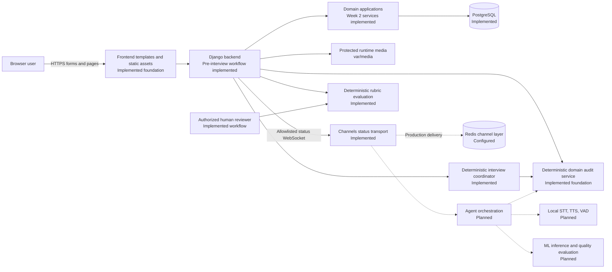
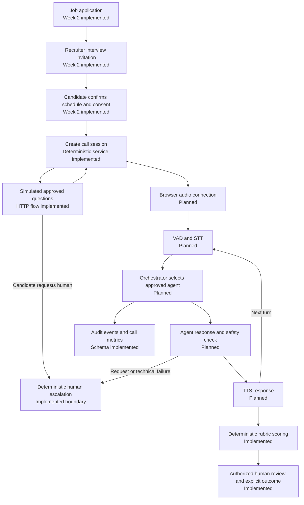
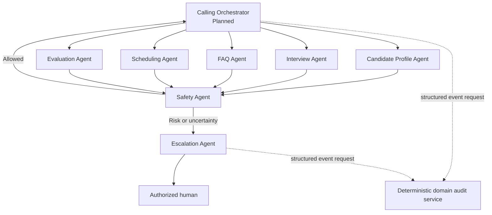

# Architecture

This document describes both the implemented foundation and the planned system. Labels in the diagrams distinguish them; a planned box is not a claim of completed functionality.

## Status summary

Implemented today: Django configuration, PostgreSQL models/migrations, accounts web flow, role dashboards, resume validation, authentication audit signals, deterministic domain-audit validation, immutable audit/consent protection, append-only consent services, secure email-verification services, explicit recruitment and call-session transition policies, templates/static discovery, runtime path separation, and a fail-closed production/deployment configuration boundary.

Implemented Week 2 product workflows: candidate profile/consent/verification/resume management, administrator/recruiter provisioning, company-scoped jobs, secure applications/withdrawal, and interview invitation/confirmation/rescheduling. Completed Week 3 adds the deterministic call-session domain, server-rendered simulated interview, authenticated status WebSocket, optional local voice adapter boundaries, model-free deterministic interview coordinator, expiry processing, and privacy-safe human escalation. Week 4 now includes deterministic weighted rubric scoring, an authorized explicitly human-finalized review workflow, synthetic evaluation-quality/safety coverage, a dry-run-first answer/transcript retention foundation, verified ignored local-model inference, and a QA-only three-turn Qwen/MiniLM/speech-to-Django command. Cloud deployment adopts Google Gemini API (`gemini-3.1-flash-lite`) via standard HTTP REST integration for remote inference, bypassing local GGUF models and high RAM requirements. Outgoing email verification and separate interview confirmation steps have been removed in favor of direct in-app candidate flows. Browser microphone transcription now runs Silero VAD before Faster-Whisper and QA settings can stream transient Piper question audio. Manual browser QA and the corrected persisted QA command still require execution; real candidate-facing model actions remain disabled.

## Overall system architecture

## Browser frontend

The frontend uses Django-rendered HTML in `frontend/templates/` and shared assets in `frontend/static/`. Existing pages cover signup, login, role dashboards, candidate profile/consent, email verification, resume management, and the clearly labelled simulated interview. Templates are deliberately semantic and minimally styled until Figma screenshots are supplied. Browser code must not receive database credentials, private environment values, unrestricted media paths, or privileged agent tools.

## Django backend

`backend/manage.py` starts the Django project. `backend/config/` defines shared, development, and production settings plus ASGI/WSGI entry points. `PROJECT_ROOT` is the repository root, `BACKEND_ROOT` is `backend/`, `FRONTEND_ROOT` is `frontend/`, and `BASE_DIR` remains the backend compatibility alias.

The backend owns validation, authorization, consent checks, workflow transitions, database transactions, audit creation, and access to protected storage. Client-supplied roles, ownership identifiers, scores, agent permissions, and approval flags must never be trusted directly.

## PostgreSQL database

PostgreSQL is the authoritative transactional store. Django migrations remain inside each backend application. The schema uses foreign keys, indexes, check constraints, conditional uniqueness, and UUID identifiers. Important integrity boundaries include case-insensitive unique user emails, one active resume per candidate, one current schedule per application, bounded evaluation values, ordered call/agent events, and database-protected immutable audit and consent records.

## Authentication and role permissions

`accounts.User` authenticates by email and supports candidate, recruiter, and administrator roles. Public signup creates candidates only. Server-side role and object checks restrict candidates to their records and recruiters to verified capabilities and their company. Administrator capability is reloaded from PostgreSQL and is never inferred from request data.

## Email verification

`accounts.EmailVerificationChallenge` stores a challenge UUID, user, unique keyed token digest, keyed normalized-email binding, purpose version, creation/expiry/used/invalidation timestamps, and optional request UUID. Raw tokens and URLs are never persisted. Tokens contain a cryptographically random nonce and are signed with a dedicated versioned salt; the default lifetime is 24 hours.

Creation, resend, email-change invalidation, and consumption are deterministic services. Resend invalidates prior active challenges. Consumption locks the challenge row, verifies the signature, expiry, purpose, current email binding, active user, and unused/uninvalidated state, then sets `User.email_verified` in the same transaction as the mandatory audit event. Configurable request/resend/invalid-attempt limits use privacy-safe cache keys. Generic-response pages are implemented, and application creation plus interview invitation/confirmation enforce verification inside their services.

## Candidate profiles and resume handling

Each candidate user receives one `CandidateProfile`. Candidate-only forms expose an explicit profile-field allowlist and audit changed fields. General AI consent uses the append-only service. `Resume` stores protected file metadata, processing status, extracted text, and a checksum field. Uploads use random names and accept structurally plausible PDF/DOCX files up to 5 MB. Basic pypdf/python-docx extraction runs outside long database transactions with page/archive/expanded-size/text limits. New resumes remain inactive until processing succeeds, then replace the old active resume atomically; failures preserve the old resume. Downloads require ownership. These structural controls are not malware scanning; production scanning and retention execution remain deferred.

## Recruitment domain

The recruitment schema connects companies and recruiter profiles to job postings, weighted skill requirements, applications, interview questions, and FAQs. Trusted administrators can provision companies and recruiter profiles through deterministic services or Django admin. Verified recruiters with `can_manage_jobs` use company-scoped services and semantic templates to create/edit draft jobs, add requirements/questions/FAQs, and invoke tested publishing transitions. Authenticated candidates see only open, active-company, unexpired jobs. Application services require persisted candidate role, verified email, an open/unexpired job, and a completed active resume owned by that candidate; duplicate job/candidate pairs are rejected. Application-level interview consent is optional at creation and uses append-only history. Candidate and recruiter views are object/company scoped. Pre-call withdrawal cancels a current pending/confirmed schedule and records both audit events transactionally.

## Interview scheduling and evaluation

Schedules track UTC start/end times, an IANA display timezone, state, keyed-HMAC access-token digest, invitation expiry, delivery status, and invitation idempotency. Raw invitation tokens are reconstructable only from a caller-supplied UUID plus the server secret and are never persisted or audited. Invitations expire at the earlier of 48 hours or interview start. Creation requires a verified recruiter in the application's company plus current general/application consent and verified candidate email. Row-locked confirmation is single-use and adds schedule-linked consent evidence. `InterviewRescheduleRequest` stores a candidate proposal and its pending/approved/rejected/cancelled review state; approval atomically retires the old schedule and creates a new pending invitation, while rejection preserves it. Safe delivery status supports idempotent retry without private error details.

`EvaluationRubric` and ordered weighted criteria are configured through trusted Django admin. A verified recruiter with candidate-review capability may start a review only for an application in their active company after a completed interview with evidence. `evaluation_services` row-locks the evaluation/application boundary, validates that rubric weights total 1, stores bounded criterion scores, confidence and concise reviewer evidence, and calculates the weighted overall score/confidence plus a deterministic advisory recommendation. The recommendation cannot change application state. Only a separate explicit human finalization can record `advance` or `decline`; that operation transactionally moves the application to shortlisted or rejected and writes mandatory privacy-safe evaluation/application audit events. Final evaluations and their scores are immutable through model checks and PostgreSQL triggers. Full answers, transcripts, résumé content, reviewer prose, and private notes never enter audit metadata.

## Calling sessions

`calling.CallSession` now has a UUID identity, one-session-per-schedule integrity, caller-supplied creation idempotency, explicit `pending`, `ready`, `active`, `paused`, `completed`, `cancelled`, `expired`, and `failed` states, expiry, simulated-mode, safe completion/failure codes, question position, and lifecycle timestamps. Candidate, application, job, recruiter, and company ownership are derived from the protected interview-schedule relationships rather than duplicated.

Transactional services lock the schedule or session row, reload actors from PostgreSQL, enforce confirmed/current schedule eligibility, candidate email verification, current general and application interview consent, candidate ownership, verified recruiter capability/company scope, and scheduled start/end limits. Only the candidate can start, pause, resume, or complete an interview; candidate, authorized recruiter, or administrator can cancel; readiness, expiry, and failure are system transitions. Every successful creation or transition produces a mandatory allowlisted audit event in the same transaction, so audit failure rolls the state change back. Repeat submission of the same creation idempotency key returns the original session; a different key cannot create another session for the schedule.

`calling.SimulatedInterviewResponse` stores one bounded private answer per approved job question and session, with deterministic question indexes and UUID idempotency. The candidate pages expose one active question at a time and use POST/CSRF-protected preparation, start, pause, resume, answer, and cancellation operations. An optional candidate-only local transcription endpoint accepts one bounded browser audio clip, rechecks current ownership/consent/schedule/session/question gates, decodes it only in memory, invokes local Faster-Whisper, and returns editable text without persisting it. The candidate must use the existing submit action to store an answer. Raw audio and unsubmitted transcript text never enter storage, audit metadata, status WebSockets, or reviewer views. Recruiter/administrator pages expose safe operational progress without answer content.

Persistent audio recording is not used by this runtime. Existing speech-engine, transcript, event, and metric schema remains a foundation only. Channels/Redis status transport is implemented, with the validated HTTP simulation retained as fallback; browser audio transport is not implemented.

The implemented WebSocket path uses Django session authentication, origin/host validation, exact session authorization, and UUID-derived per-session channel groups. Candidate connections are owner-only; recruiters must remain verified, retain candidate-review capability, and match the job company; administrators are explicit trusted actors. Authorization is reloaded before each delivered update. Outgoing snapshots contain only type, session UUID, lifecycle status, question index, and simulated-mode flag. Caller-supplied channel event bodies are never forwarded, so answer text, transcript content, résumés, tokens, prompts, filesystem paths, and secrets cannot enter the WebSocket schema. PostgreSQL remains authoritative and on-commit broadcasts are optional; Redis/channel failure leaves the HTTP flow usable.

## Recruitment call workflow

## Multi-agent orchestration

Agent definitions, versions, runs, actions, handoffs, approvals, and escalations have persistent models. The implemented deterministic coordinator controls the simulated interview's narrow candidate actions; broader planned orchestration will control which specialist receives a turn and which allowlisted tools it may use. Agents receive minimum necessary context and return structured, auditable results.

Deterministic Python policy enforcement remains authoritative for permissions, consent, transitions, tool allowlists, approvals, rate limits, and protected fields. The future semantic Safety Agent detects prompt injection, bias, coercion, privacy concerns, and unsafe conversational content but cannot override hard controls. The escalation agent must create a reviewable record and route it to a human; it must not silently resolve high-impact cases.

Future agents never receive unrestricted ORM, SQL, filesystem, model-name, field-name, or recipient access. Each tool must call a narrow Python service with validated input, authorization context, consent enforcement, idempotency where required, mandatory audit recording, structured output, and safe errors.

The implemented `DeterministicInterviewCoordinator` is the first orchestration boundary and is deliberately not an LLM. Its immutable command surface is status, start, pause, cancel, submit answer, and request human. A candidate-scoped Django adapter reloads authority and calls the existing transactional services; the coordinator itself receives typed snapshots and structured safe failures. It returns only a start directive, one approved question, paused/terminal/escalated state, or stopped result. It has no message delivery, arbitrary ORM, filesystem, model-selection, scoring, hiring, or final-decision tool.

An exploratory `InterviewReasoningAgent` prototype runs a real local model only in a short-lived subprocess and returns a validated proposal to a read-only coordinator bridge. It has no HTTP route and cannot execute tools, alter state, or create hiring outcomes. Its first 0.5B CPU model did not pass contextual-quality validation, so this prototype is not an operational agent and must not be enabled until a stronger model passes the documented real-inference and safety evaluation.

Task 1 adds a detached shared AI foundation: one loopback-only `llama.cpp` process owns an explicitly downloaded Qwen2.5-3B Q4_K_M model and serializes generation through a single lock. Native failures are isolated from Django. The local response request carries a JSON schema whose action enum is derived from the immutable agent contract; the bounded runner still validates the result and fails closed. A 100-case synthetic held-out run reached 99 accepted contextual actions and 100 valid schemas, but still recorded one contradictory-interview miss. Nine immutable logical-agent contracts can request validated proposals but cannot execute their listed tools; real domain actions remain narrow Django services. The local hybrid RAG index uses pinned MiniLM ONNX embeddings plus keyword score, filters company/candidate/consent permissions before ranking, labels prompt-injection-like source text as untrusted data, and has no persistence/schema migration. PostgreSQL remains authoritative for authorization and exact domain facts; pgvector is deferred pending approval.

Any future model-proposal-to-Django write adapter must be QA-only, feature-gated,
and run solely against an explicitly configured disposable PostgreSQL QA
database with isolated credentials. It must fail closed if that exact QA
database cannot be verified. The current `--reuse-db` pytest configuration is
not sufficient proof of this isolation, so it is not an execution environment
for new Qwen-driven write-path tests.

The implemented release adapter is a management-command-only exception to the
detached boundary. It verifies the exact QA database and role, creates only
bounded `QA_` synthetic records, processes three transient speech turns before
releasing speech models, then starts one Qwen worker. Permission-filtered MiniLM
sources are supplied as untrusted data. Only a schema-valid Interview `continue`
proposal may invoke the existing deterministic coordinator. Completion is
followed by a real Evaluation-agent advisory proposal and the existing
recruiter-authorized deterministic scoring service; no human outcome is
finalized. Any failure stops before the proposed answer write.

`agents.escalation_services` provides the deterministic human-review boundary. Candidate-requested assistance pauses an active session, creates one idempotent `AgentEscalation`, and records a canonical allowlisted audit event in one transaction. Technical runtime failures atomically move the session to `failed` and create a high-severity review record. PostgreSQL-backed actor/ownership checks, UUID idempotency, fixed policy descriptions, and privacy-safe codes prevent callers from inserting private prose. Audit failure rolls the session and escalation back together. `expire_due_call_sessions` row-locks non-terminal due sessions and transitions them to `expired`; no employment decision is made by either service.

## Speech and ML components

`ai_system/voice/interfaces.py` defines typed transient mono PCM input plus VAD, STT, TTS, audio-input, and audio-output contracts. `ml/voice/local_adapters.py` implements optional lazy adapters for Silero VAD, Faster Whisper, and piper-plus. Faster Whisper uses local-only model loading; Piper requires a trusted local `.onnx` model path. Ignored local Faster-Whisper base, Silero VAD, and native Piper Plus weights have passed a synthetic in-memory CPU smoke check; this is not browser microphone QA or a claim of production voice quality. Missing dependencies/models, unsupported microphone input, and processing failures return fixed safe codes without exposing paths or exception text.

Audio stays in memory and recording is not persisted. Candidate browser clips are decoded in memory, checked by Silero VAD, rejected when silent, and passed to Faster-Whisper only after the existing ownership/consent/state checks. QA-only Piper playback streams the current approved question with `no-store`; it creates no answer or recording. Adapter results do not authorize tools or employment outcomes. Manual microphone/listening QA, production quality, and public deployment remain unverified.

## Audit logging

`AuditEvent` records actors, categories, outcomes, severity, resource references, privacy-safe request metadata, chained fields, and a keyed integrity hash. Django blocks model-level modification/deletion and a PostgreSQL migration installs triggers that block bulk updates/deletes. Authentication signals record successful login, failed login with a hashed identifier, and logout.

The deterministic domain audit service accepts a frozen structured command, matches it to an immutable domain-event registry, and derives the human-readable action only from that registered specification. Each specification declares required and allowed metadata keys. The service normalizes UUID identifiers, enforces actor/resource requirements, and accepts only bounded allowlisted scalar metadata. It rejects missing required metadata, unknown events and metadata, nested private objects, credentials, raw tokens, document/transcript contents, and filesystem paths. Mandatory audit failures raise safe exceptions and can participate in the calling domain service's transaction. An LLM never decides whether auditing is required, which mandatory fields may be omitted, whether an event may change, or whether private content belongs in metadata. Previous-event hash chaining remains unimplemented by design.

## Retention and incident readiness

`auditlog.retention_services` implements the first deterministic retention boundary. Supported categories are `simulated_interview_answers` and `transcript_segments`. Eligibility requires a terminal call session whose end time is older than the reviewed policy period; active/recent sessions and already-cleared rows are excluded. Dry-run is read-only, applied batches are explicitly requested, bounded to 500 rows, row-locked, replay-safe through a unique run UUID, and committed with one normalized `DataRetentionRecord` plus one mandatory privacy-safe `retention.applied` audit event. Audit failure rolls private-content changes back.

Anonymization clears only private answer/transcript text and preserves the question, speaker, sequence, timing, call/application relationships, and operational status. It does not delete protected media or mutate profiles, applications, schedules, escalations, audit events, consent evidence, finalized evaluations, criterion scores, security incidents, or prior retention records. Résumé/file deletion is deliberately excluded because external protected-storage deletion and legally reviewed retention are not configured. The policy is a technical safety default, not legal advice or a compliance guarantee.

The [incident-response runbook](security/INCIDENT_RESPONSE.md) defines safe containment for exposure, unauthorized access, failed retention, review-integrity concerns, and outages. The [backup/restore checklist](../database/docs/BACKUP_RESTORE.md) is explicitly unverified; no backup service is claimed to exist.

## Production and deployment boundary

`config.settings_production` fails closed when debug mode, signing-key quality, explicit hosts/origins, PostgreSQL with approved SSL, TLS Redis, or HTTPS redirect requirements are not met. Secure cookies, security headers, WhiteNoise static storage, connection health checks, explicit reverse-proxy trust, and staged HSTS are configured without changing development settings. HSTS begins disabled and may be increased only after HTTPS verification; subdomain and preload flags require a positive duration.

The root `/health/` endpoint is an unauthenticated fixed liveness response for GET/HEAD. It contains no database, Redis, version, package, configuration, or private state and deliberately does not test dependencies. No public media route exists. Production request/security logs omit request messages, and the future Daphne command disables access logging so bearer tokens in existing verification/invitation paths are not written to provider logs.

The tracked Render boundary uses `requirements/render.txt`, `render.yaml`, `build.sh`, and `.python-version`. Build installs the lightweight dependency set and runs `collectstatic`; it does not migrate. PostgreSQL, TLS Redis, and private host/origin/signing configuration remain provider environment inputs. Render's ephemeral filesystem is not approved for persistent uploads, so external protected media storage is still required before real use. No cloud account, provider resource, backup, monitor, email service, migration run, or deployment is created by these files.

## Consent history

The committed Week 2 architecture includes `auditlog.ConsentRecord` as append-only governance evidence for general AI-processing and application-level AI-interview consent. Its exact fields are UUID `id`; protected `candidate`; consent type (`general_ai_processing` or `ai_interview`); action (`granted` or `revoked`); policy version; collection source (`profile`, `application`, `interview_confirmation`, `admin_assisted`, or `legacy_import`); optional protected application, interview schedule, and recorded-by user; timezone-aware recorded time; globally unique UUID idempotency key; and optional request/correlation UUIDs.

Named checks are `consent_general_no_context`, `consent_interview_has_app`, `consent_schedule_has_app`, and `consent_nonlegacy_has_actor`. Named indexes are `consent_candidate_type_time`, `consent_app_type_time`, `consent_schedule_time`, `consent_action_time`, `consent_request_id`, and `consent_correlation_id`. Model methods reject updates/deletes and PostgreSQL independently blocks both operations.

Deterministic consent services lock the mutable `CandidateProfile` or `JobApplication` cache owner, reload actor and schedule authority from PostgreSQL, validate scope and ownership, persist consent evidence, synchronize the Boolean cache, and record the mandatory audit event in one short transaction. Candidate-originated evidence requires the persisted actor to be the active candidate user with the candidate role; administrator evidence must use the `admin_assisted` source. An identical persisted idempotency key returns its existing record and reuse with different consent semantics is rejected. A different key represents a new explicit action and creates a new record and audit event, so network retries must reuse their original key.

Effective-consent checks read the latest record across all policy versions, ordered by recorded time and UUID. Consent is effective only when that latest action is granted under the requested non-legacy policy. A later revocation or different-policy action blocks the earlier grant; a later current-policy grant restores consent. Boolean caches follow every new latest action but are never the source of authority.

Audit events use `resource_type = "auditlog.ConsentRecord"`, the consent UUID as `resource_id`, and only allowlisted identifiers/codes; no wording or private prose is copied. Legacy true cache values become `legacy-unversioned` historical grants with no actor or migration-time audit event, then profile/application caches are reset so legacy evidence cannot authorize future processing. False caches do not create misleading revocations. This is technical evidence handling, not a claim of legal compliance.

## Data and security flow

```mermaid
flowchart LR
    INPUT[Untrusted browser input] --> VALIDATE[Django forms, validators,<br/>CSRF and authorization]
    VALIDATE -->|Accepted structured data| DB[(PostgreSQL)]
    VALIDATE -->|Approved upload| MEDIA[Protected var/media storage]
    MEDIA -. Planned malware and text processing .-> PROC[Isolated processing]
    DB -->|Minimum necessary context| AGENT[Planned agent tool boundary]
    PROC -. Redacted approved text .-> AGENT
    AGENT --> SAFETY[Safety and policy check]
    SAFETY -->|Low-risk advisory output| REVIEW[Authorized human review]
    SAFETY -->|Risk or uncertainty| ESC[Escalation queue]
    VALIDATE --> AUDIT[Sanitized immutable audit event]
    AGENT --> AUDIT
    REVIEW --> AUDIT
    ESC --> AUDIT
    SECRETS[Private environment configuration] --> DJANGO[Django server only]
    SECRETS -. never to .-> INPUT
    SECRETS -. never to .-> AGENT
```

## Human approval boundaries

AI can ask approved questions, summarize, identify evidence, calculate rubric-based advisory scores, and recommend review. It cannot independently publish jobs, change privileged roles, enable recording, disclose private data, resolve serious incidents, or make final hiring/rejection decisions unless a narrowly defined action is explicitly approved by an authorized human and policy permits it. Final employment outcomes always require human review.

## Runtime storage

- `var/media/`: uploaded resumes and any future protected recordings; contents ignored by Git.
- `var/static/`: collected static output; contents ignored by Git.
- `var/logs/`: runtime logs; contents ignored by Git.
- `var/agent-state/`: local non-secret agent counters/state; contents ignored except `.gitkeep`.
- `ml/artifacts/`, `ml/datasets/`, `ml/checkpoints/`: local generated or downloaded ML content; contents ignored by Git.

Real database backups, credentials, transcripts, candidate documents, and recordings must never be stored in tracked paths.

## Security boundaries

1. **Browser/server:** Validate all input, enforce CSRF, authenticate, authorize, and expose only necessary data.
2. **Server/database:** Use least-privilege credentials, transactions, constraints, and migrations; never embed secrets in code or docs.
3. **Uploads/processing:** Treat files as hostile, store outside static assets, scan before production processing, and enforce ownership and retention.
4. **Backend/agents:** Use allowlisted typed tools, minimum context, timeouts, structured outputs, redaction, and immutable audit events.
5. **AI/human decision:** Keep AI output advisory and require authorized human review for final employment decisions and serious escalations.
6. **Source/runtime:** Keep runtime data, model artifacts, secrets, and private candidate content outside Git.

## Pakistan time boundary

The application uses `Asia/Karachi` as its fixed business and display timezone while Django keeps timezone-aware values in UTC. Ordinary browser forms cannot select a timezone; scheduling services reject non-Pakistan timezone values, and legacy stored timezone fields are retained only for compatibility rather than trusted presentation.

## Text-only production boundary (2026-11-06)

`config.settings_production` forces `SPEECH_FEATURE_ENABLED=False`. Candidate
interview pages then omit microphone, transcription, and Piper controls (and
their JavaScript); the corresponding endpoints reject before an adapter is
created. The lazy local adapter code and models remain available only to local
development and isolated QA. Text answer submission continues through the
existing deterministic call-session service.

## QA release native-model preflight (2026-11-06)

`backend/manage.py run_qa_release_interview` has a command-specific local supervisor before Django import: read-only QA verifier → short-lived speech worker → supervised loopback llama.cpp → Django command. The speech worker receives only model/audio configuration and fixed synthetic text; database, settings-module, password, secret, and token variables are removed. Its process exit releases native Piper, Silero, and Faster-Whisper allocations before Qwen loads. The llama child is loopback-only, bounded to two threads and a 1024-token context for this QA command, and belongs to a Windows kill-on-close job object. The Django workflow receives only validated transcript/VAD tuples and the already-started runtime, re-verifies the exact QA database identity, then delegates all persistence to existing deterministic services.
