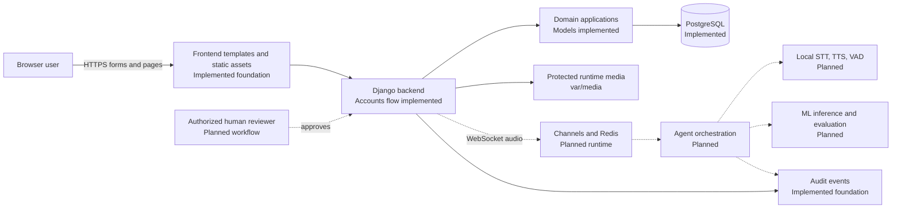
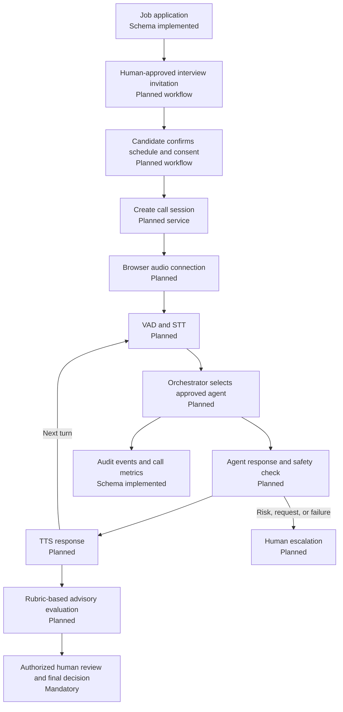
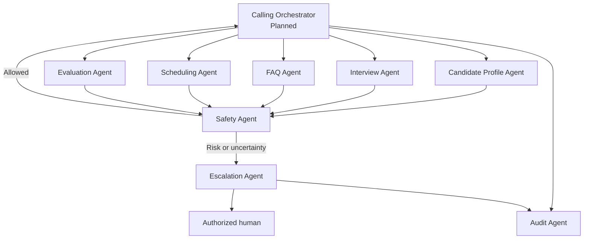

# Architecture

This document describes both the implemented foundation and the planned system. Labels in the diagrams distinguish them; a planned box is not a claim of completed functionality.

## Status summary

Implemented today: Django configuration, PostgreSQL models/migrations, accounts web flow, role dashboards, resume validation, authentication audit signals, database audit protection, templates/static discovery, and runtime path separation.

Planned: candidate/recruiter workflow views, browser audio transport, local speech execution, multi-agent orchestration, ML inference, safety enforcement services, human review UI, retention jobs, and end-to-end operations.

## Overall system architecture

## Browser frontend

The frontend uses Django-rendered HTML in `frontend/templates/` and shared assets in `frontend/static/`. The existing pages cover signup, login, and role-specific dashboard shells. Future pages should remain server-authorized and follow supplied Figma screenshots. Browser code must not receive database credentials, private environment values, unrestricted media paths, or privileged agent tools.

## Django backend

`backend/manage.py` starts the Django project. `backend/config/` defines shared, development, and production settings plus ASGI/WSGI entry points. `PROJECT_ROOT` is the repository root, `BACKEND_ROOT` is `backend/`, `FRONTEND_ROOT` is `frontend/`, and `BASE_DIR` remains the backend compatibility alias.

The backend owns validation, authorization, consent checks, workflow transitions, database transactions, audit creation, and access to protected storage. Client-supplied roles, ownership identifiers, scores, agent permissions, and approval flags must never be trusted directly.

## PostgreSQL database

PostgreSQL is the authoritative transactional store. Django migrations remain inside each backend application. The schema uses foreign keys, indexes, check constraints, conditional uniqueness, and UUID identifiers. Important integrity boundaries include case-insensitive unique user emails, one active resume per candidate, one current schedule per application, bounded evaluation values, ordered call/agent events, and database-protected immutable audit events.

## Authentication and role permissions

`accounts.User` authenticates by email and supports candidate, recruiter, and administrator roles. Public signup creates candidates only. Existing dashboard authorization is enforced in Django views. Future object-level checks must ensure candidates access only their own records and recruiters access only authorized company/job records. Administrator capability must not be inferred from request data.

## Candidate profiles and resume handling

Each candidate user receives one `CandidateProfile`. Candidate skills can be self-reported or derived from approved processing. `Resume` stores protected file metadata, processing status, extracted text, and a checksum field. Upload paths use random names; validators accept structurally plausible PDF/DOCX files up to 5 MB. Upload views, ownership enforcement, extraction, malware scanning, and retention execution are planned.

## Recruitment domain

The recruitment schema connects companies and recruiter profiles to job postings, weighted skill requirements, applications, interview questions, and FAQs. Applications link a candidate and optional resume to one job and include consent for AI interviewing. User-facing management workflows are planned for Week 2.

## Interview scheduling and evaluation

Schedules track start/end times, timezone, state, access-token hashes, invitation state, and rescheduling. Rubrics contain weighted criteria; evaluations capture evidence, confidence, scores, advisory recommendations, model/prompt versions, and human-review fields. The operational scheduler and review interface are planned. Setting an evaluation as final must be restricted to an authorized human workflow.

## Calling sessions

The call schema records consent, lifecycle state, speech-engine identifiers, optional recording metadata, transcript segments, events, and metrics. Recording defaults to disabled. The planned runtime uses Channels with Redis in production for browser communication and must handle reconnects, timeouts, interruption, and clean termination without losing auditability.

## Recruitment call workflow

## Multi-agent orchestration

Agent definitions, versions, runs, actions, handoffs, approvals, and escalations have persistent models. The planned orchestrator controls which specialist receives a turn and which allowlisted tools it may use. Agents receive minimum necessary context and return structured, auditable results.

The safety agent must detect privacy, bias, policy, malicious-input, and unsafe-tool conditions. The escalation agent must create a reviewable record and route it to a human; it must not silently resolve high-impact cases.

## Speech and ML components

The planned local speech path uses Silero VAD to find speech boundaries, Faster Whisper to transcribe, and Piper to synthesize responses. ML code belongs in `ml/`, while orchestration and safety policy belong in `ai_system/`. Models, datasets, checkpoints, and generated artifacts are ignored by Git. Evaluation must measure quality, bias, confidence, latency, and failure behavior before production use.

## Audit logging

`AuditEvent` records actors, categories, outcomes, severity, resource references, privacy-safe request metadata, chained fields, and a keyed integrity hash. Django blocks model-level modification/deletion and a PostgreSQL migration installs triggers that block bulk updates/deletes. Authentication signals record successful login, failed login with a hashed identifier, and logout. Future domain and agent actions must add sanitized audit coverage.

## Data and security flow

```mermaid
flowchart LR
    INPUT[Untrusted browser input] --> VALIDATE[Django forms, validators,<br/>CSRF and authorization]
    VALIDATE -->|Accepted structured data| DB[(PostgreSQL)]
    VALIDATE -->|Approved upload| MEDIA[Protected var/media storage]
    MEDIA -. Planned malware and text processing .-> PROC[Isolated processing]
    DB -->|Minimum necessary context| AGENT[Planned agent tool boundary]
    PROC -. Redacted approved text .-> AGENT
    AGENT --> SAFETY[Safety and policy check]
    SAFETY -->|Low-risk advisory output| REVIEW[Authorized human review]
    SAFETY -->|Risk or uncertainty| ESC[Escalation queue]
    VALIDATE --> AUDIT[Sanitized immutable audit event]
    AGENT --> AUDIT
    REVIEW --> AUDIT
    ESC --> AUDIT
    SECRETS[Private environment configuration] --> DJANGO[Django server only]
    SECRETS -. never to .-> INPUT
    SECRETS -. never to .-> AGENT
```

## Human approval boundaries

AI can ask approved questions, summarize, identify evidence, calculate rubric-based advisory scores, and recommend review. It cannot independently publish jobs, change privileged roles, enable recording, disclose private data, resolve serious incidents, or make final hiring/rejection decisions unless a narrowly defined action is explicitly approved by an authorized human and policy permits it. Final employment outcomes always require human review.

## Runtime storage

- `var/media/`: uploaded resumes and any future protected recordings; contents ignored by Git.
- `var/static/`: collected static output; contents ignored by Git.
- `var/logs/`: runtime logs; contents ignored by Git.
- `var/agent-state/`: local non-secret agent counters/state; contents ignored except `.gitkeep`.
- `ml/artifacts/`, `ml/datasets/`, `ml/checkpoints/`: local generated or downloaded ML content; contents ignored by Git.

Real database backups, credentials, transcripts, candidate documents, and recordings must never be stored in tracked paths.

## Security boundaries

1. **Browser/server:** Validate all input, enforce CSRF, authenticate, authorize, and expose only necessary data.
2. **Server/database:** Use least-privilege credentials, transactions, constraints, and migrations; never embed secrets in code or docs.
3. **Uploads/processing:** Treat files as hostile, store outside static assets, scan before production processing, and enforce ownership and retention.
4. **Backend/agents:** Use allowlisted typed tools, minimum context, timeouts, structured outputs, redaction, and immutable audit events.
5. **AI/human decision:** Keep AI output advisory and require authorized human review for final employment decisions and serious escalations.
6. **Source/runtime:** Keep runtime data, model artifacts, secrets, and private candidate content outside Git.
